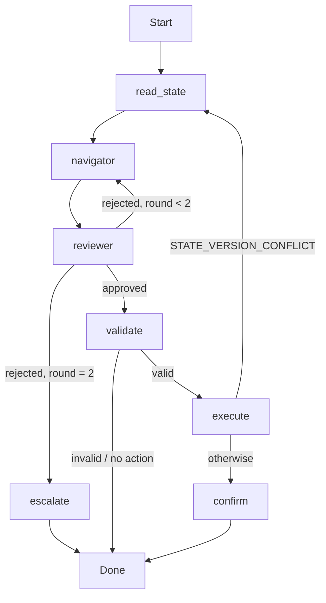

# 👋 Hi, I'm Pedro Cavalcante

🎓 Computer Science student at UNIFAVIP, Recife/Brazil — graduating Dec/2027
🔨 Full-stack developer — C# / .NET on the back end, React / Node.js on the product side
🌍 Open to remote and international full-stack or back-end roles

I'm currently the **co-founder and Tech Lead of Nexora**, an AI-assisted supply-chain simulator that I co-created and am building, as sole developer, with a real industrial client — and I take on freelance full-stack projects. Before that, I spent Oct 2025 – Jul 2026 at **Linkup³**, a startup, building a real-time integrations monitoring platform from the first MVP definition. In parallel, I completed Deloitte's intensive .NET Bootcamp (with Porto Digital), where I built back-end systems with Clean Architecture, async processing, and automated testing.

## 🧭 What I'm doing now

* 🏭 **Nexora** — co-founder and Tech Lead of an AI supply-chain digital twin, built with a bioplastics company (client under NDA) on real operational data
* 💼 **Freelance full-stack developer** — websites and online stores for small businesses, from requirements and scope negotiation to delivery
* 🧪 **Atlas** — a micro-SaaS for small businesses to prioritize accounts receivable (v0, public repo)
* 🤖 **Building AI agents in Python** — multi-agent workflows with LangGraph, tool use through MCP, RAG, and LLM tracing with Langfuse
* 📈 **Studying** toward backend + cloud specialization (Python, AWS) as the next phase of my career

## 💼 Experience

**Nexora — Co-founder & Tech Lead** · Oct 2026 – present
* Co-created the product and lead its technical development as the sole developer
* Designing and building a simulator that lets the operator test demand, delivery-date and price scenarios and see where the production chain would bottleneck — before it happens
* Turning real client data into a calibrated model, with scope and deliverables agreed in fortnightly review cycles
* 5th place among 44 startups at Inova Poli — earned a scholarship and a spot in the pre-incubation program

**Freelance Full-Stack Developer** · Self-employed
* Build websites and online stores for small businesses, working directly with clients
* Own the whole cycle: requirements, scope and deadlines, development, and delivery

**Software Developer — Linkup³ (startup)** · Oct 2025 – Jul 2026
* Built the React 18 + Vite + Tailwind front end and integrated it with a Node.js / Express / Prisma REST API
* Developed real-time monitoring: dashboards with live KPIs, automatic ticketing, and severity-based notifications
* Built an if-then automation engine triggered by system events
* Implemented JWT authentication and role-based access control (RBAC)

**Deloitte .NET Bootcamp** · Jan – Feb 2026 · 64h, in partnership with Porto Digital
* Back-end projects around Clean Architecture, resilience patterns, and automated testing

## ⚙️ Tech Stack

**Front-end**

**Back-end**

**Databases & Infra**

**AI & Agents**

**Practices**
`JWT / RBAC` · `REST / OpenAPI` · `Clean Architecture` · `xUnit` · `Vitest` · `Testcontainers`

## 🚀 Featured Projects

### 🏭 Nexora — AI Supply Chain Digital Twin
*In development · private repository (client under NDA)*
A simulator for industrial supply chains: the operator feeds in demand and delivery forecasts, and the system simulates date and price scenarios and shows where the chain gets stuck — supplier, production, fees — with a plan B. Built with a bioplastics company's real operational data. I'm the co-founder, Tech Lead, and sole developer. Placed 5th of 44 startups at Inova Poli.
<!-- TODO: add Nexora stack chips here (invisible on GitHub until filled) -->

### Multi-Agent Fleet Control — LangGraph + MCP
*Private repository*
Two LLM agents with different roles — a navigator that proposes an action and a reviewer that approves or rejects it — in a correction loop capped in code. Approved actions go through a deterministic validator and are executed via an MCP server with typed tool schemas, state versioning (never act on stale data) and idempotency keys (a retry never applies twice). Covered by contract tests for commit, duplicate, version conflict and invalid schema; server state is in-memory, at demo scale. Also built: a RAG pipeline that answers from a document set, cites its sources, and returns a fixed fallback when the question is out of scope.
`Python` `LangGraph` `LangChain` `FastMCP` `Pydantic` `Groq` `Langfuse` `pytest`

Agent graph

### [Linkup³](https://github.com/Pedrocavalcante87/Linkup3) — Real-Time Integrations Monitoring Platform
Startup MVP I built as a developer (Oct 2025 – Jul 2026): dashboards with live KPIs, automated ticket alerts, an if-then automation engine, and role-based access control.
`React` `Vite` `Tailwind CSS` `Node.js` `Express` `Prisma` `JWT/RBAC`

### [Gestão de Lotes de Minério](https://github.com/Pedrocavalcante87/Deloitte-bootcamp) — Async Processing & Resilience
Advanced bootcamp project focused on distributed-systems patterns: Redis Streams for async processing, distributed caching, and a Dead Letter Queue for failure handling — with full integration test coverage.
`.NET 10` `Redis Streams` `EF Core` `xUnit` `Testcontainers`

### [MinaOps](https://github.com/Pedrocavalcante87/MinaOps) — Heavy Equipment Monitoring API
Final challenge of Deloitte's .NET Bootcamp. A REST API for managing a mining equipment fleet (trucks, excavators, drills), built with Clean Architecture across 4 layers.
`ASP.NET Core Minimal APIs` `EF Core` `PostgreSQL` `Docker` `Swagger/OpenAPI`

### [Atlas](https://github.com/Pedrocavalcante87/atlas-v0) — Accounts Receivable Prioritization
*v0 · in development.* A micro-SaaS for small Brazilian businesses: imports ERP data through a preview-then-confirm CSV flow, groups receivables by client, and generates consolidated WhatsApp collection messages, with Row Level Security on the database.
`Next.js` `Supabase` `PostgreSQL`

## 🧠 What I'm learning about building AI agents

* **Agents as graphs.** Shared state is the only channel between nodes. Loops need a hard cap, and that cap lives in code, not in the prompt.
* **Separation of roles.** The reviewer never sees the proposer's justification: a well-written reason can persuade an LLM, a bare action can't.
* **Defense in depth.** LLM reviewer (opinion) → deterministic validator (guarantee) → server-side rules. Each layer catches what the previous one lets through.
* **Safe actions with MCP.** Typed tool schemas, `state_version` to avoid acting on stale data, and `idempotency_key` so retries are safe.
* **RAG that can say "I don't know".** Chunk by section and keep the header in the chunk; sources come from retrieval metadata, not from what the model writes.
* **LLM reliability.** `temperature=0` did not give identical outputs, and arithmetic belongs in code (tools), not in the model.

## 📚 Building Toward

* Python & backend engineering for cloud-native systems
* AI agents in production: multi-agent orchestration, guardrails, tool use through MCP, and LLM observability
* AWS fundamentals and cloud architecture
* System design for distributed, resilient services
* Application security fundamentals (OWASP Top 10, OAuth2)

## 📬 Contact

📧 [workpedro87@gmail.com](mailto:workpedro87@gmail.com) · 💼 [LinkedIn](https://www.linkedin.com/in/pedro-cavalcante-81a108204)

*Portfolio in progress — real projects, real learning, one system at a time.*
